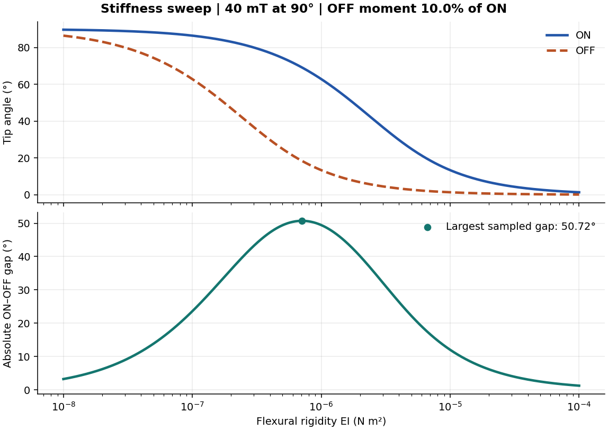
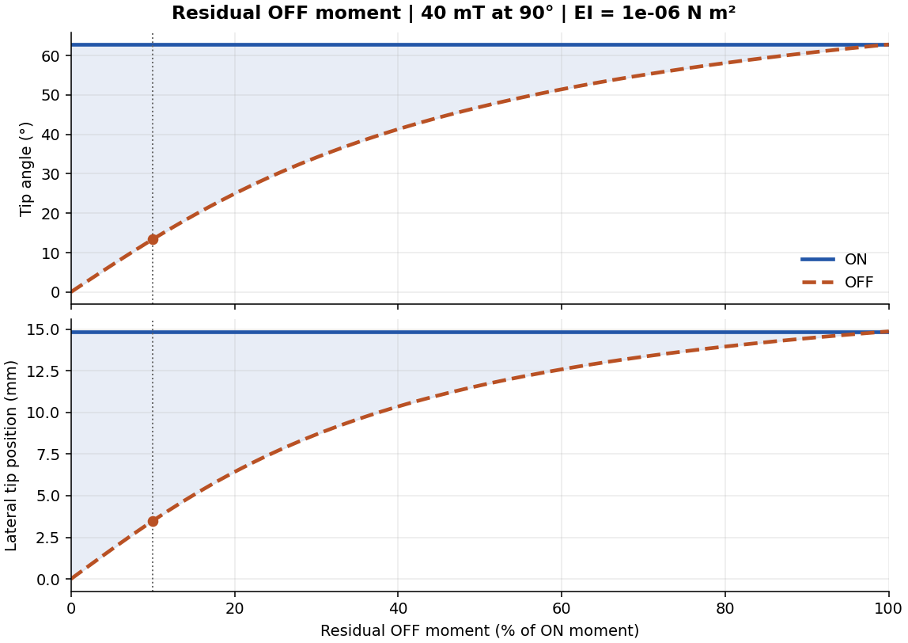

# EPM Catheter Steering Simulator

A small Python simulation of how a uniform magnetic field bends a flexible catheter tip in a plane. The example compares two effective dipole moments representing the ON and OFF states of an electropermanent magnet (EPM).


## Run the experiment

Use Python 3.10 or later.

```bash
python -m venv .venv
source .venv/bin/activate
python -m pip install -r requirements.txt
python experiment.py
python -m unittest discover -v
```

The experiment writes a plot and a CSV of tip angles and positions to `output/`. The committed [plot](field_sweep.png) and [CSV](field_sweep.csv) show the default run. Use `python experiment.py --help` to see all parameters. For example, this run reverses the field angle and sets the residual OFF moment to zero.

```bash
python experiment.py --field-angle-deg -60 --off-ratio 0 --output-dir output/reversed
```

## Model

The catheter tip is an inextensible flexible segment of length $L$ and uniform flexural rigidity $EI$. Its magnetic dipole points along the local tip tangent. The applied field has magnitude $B$ and angle $\phi$ relative to the clamped base. Under static equilibrium, the elastic and magnetic torques balance.

$$
\frac{EI}{L}\theta = mB\sin(\phi-\theta)
$$

The solver brackets the signed tip angle $\theta$ between the base tangent and the field direction for $|\phi| < 180^\circ$. The resulting centerline is a circular arc with curvature $\theta/L$.

Each EPM state is represented by a fixed effective dipole moment $m$. The switching pulse, magnetic hysteresis, field gradients, wall contact, and transient motion are outside the model. All parameter values are illustrative. The example uses a 30 mm segment, $EI=10^{-6}\,\mathrm{N\,m^2}$, an ON moment of $2\times10^{-3}\,\mathrm{A\,m^2}$, and a residual OFF moment of 10% of ON. No hardware measurements are used.

## Field sweep result

The field points 90° from the base and increases from 0 to 40 mT.

| State at 40 mT | Tip angle | Lateral deflection |
| --- | ---: | ---: |
| ON | 62.82° | 14.86 mm |
| OFF | 13.38° | 3.49 mm |

The angle describes the tip tangent. Lateral deflection is the tip's distance from the undeformed axis in this plane.

## Stiffness sweep

```bash
python stiffness_sweep.py
```

The [plot](stiffness_sweep.png) and [CSV](stiffness_sweep.csv) show 401 logarithmically spaced values of flexural rigidity $EI$ from $10^{-8}$ to $10^{-4}$ N m². The field stays at 40 mT and 90° to the base. Segment length and dipole moments use the default values above. The comparison metric is the absolute difference between the ON and OFF tip angles at each sampled rigidity.



| $EI$ (N m²) | ON angle | OFF angle | Absolute gap |
| ---: | ---: | ---: | ---: |
| $1.00 \times 10^{-8}$ | 89.63° | 86.40° | 3.23° |
| $7.08 \times 10^{-7}$ | 69.15° | 18.43° | 50.72° |
| $1.00 \times 10^{-4}$ | 1.37° | 0.14° | 1.24° |

The largest sampled gap occurs at intermediate rigidity. In this model, a very flexible tip approaches the field direction in both states because the OFF state retains a dipole moment. A very stiff tip has little deflection in either state. The peak depends on the assumed parameters and is a simulation result under the conditions above.

The command saves a PNG and CSV in `output/`. Run `python stiffness_sweep.py --help` to change the field, rigidity range, or residual OFF moment.

## Residual OFF moment sweep

```bash
python residual_sweep.py
```

This experiment varies the OFF dipole moment from 0% to 100% of the ON moment in 1 percentage point steps. Both states use the same external field (40 mT at 90°) and the same tip length and rigidity (30 mm and 10⁻⁶ N m²). As the OFF moment changes, the ON angle stays at 62.82° and the ON lateral position stays at 14.86 mm.



| OFF moment (% of ON) | OFF angle | Absolute angle gap | OFF lateral position |
| ---: | ---: | ---: | ---: |
| 0% | 0.00° | 62.82° | 0.00 mm |
| 5% | 6.83° | 55.99° | 1.79 mm |
| 10% | 13.38° | 49.44° | 3.49 mm |
| 25% | 29.82° | 32.99° | 7.63 mm |
| 100% | 62.82° | 0.00° | 14.86 mm |

In this example, a 10% residual magnetic moment gives about 21% of the ON angle and 23% of the ON lateral displacement. The static model evaluates the equilibrium response at each assumed moment. Switching repeatability can be assessed experimentally by measuring deflection across repeated cycles.

The [plot](residual_sweep.png) and [CSV](residual_sweep.csv) contain the default run. The command writes both files to `output/` and accepts `--help` for the field, rigidity, dipole moment, and output options.

## References

- Chautems et al., [Magnetic Continuum Device with Variable Stiffness for Minimally Invasive Surgery](https://doi.org/10.1002/aisy.201900086), Section 2.3.2. Source for the constant-curvature torque balance.
- Knaian, [Electropermanent Magnetic Connectors and Actuators](https://dspace.mit.edu/entities/publication/d65bb0a6-f490-40ba-b1dd-100bb2bfa0d8), MIT PhD thesis, 2010. Background on bistable electropermanent magnets.
